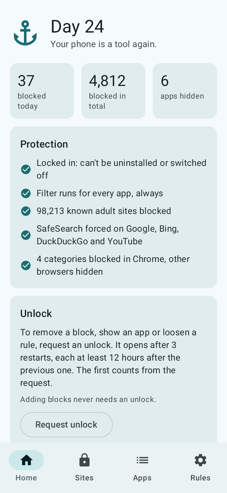
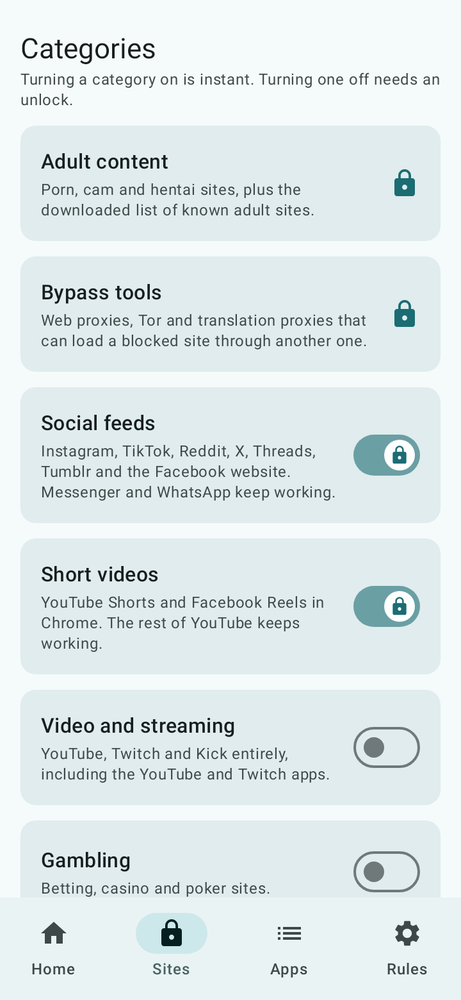
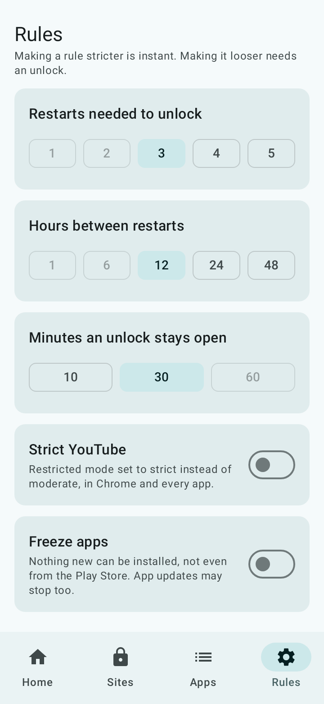
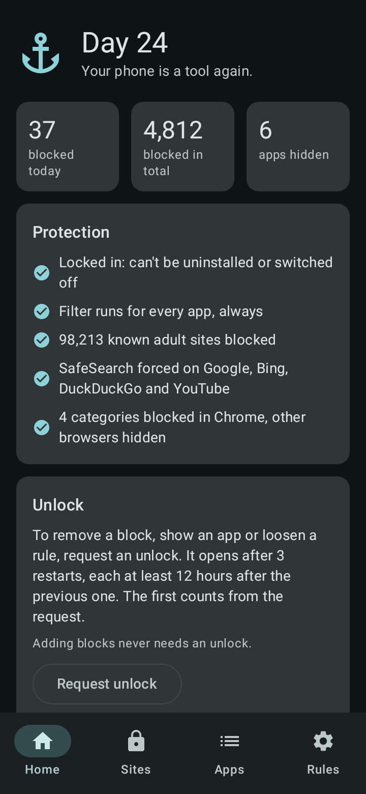
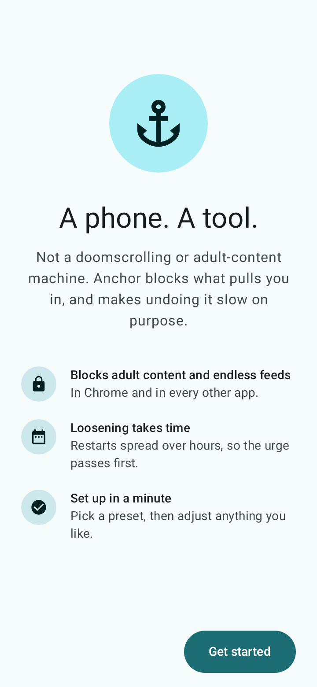
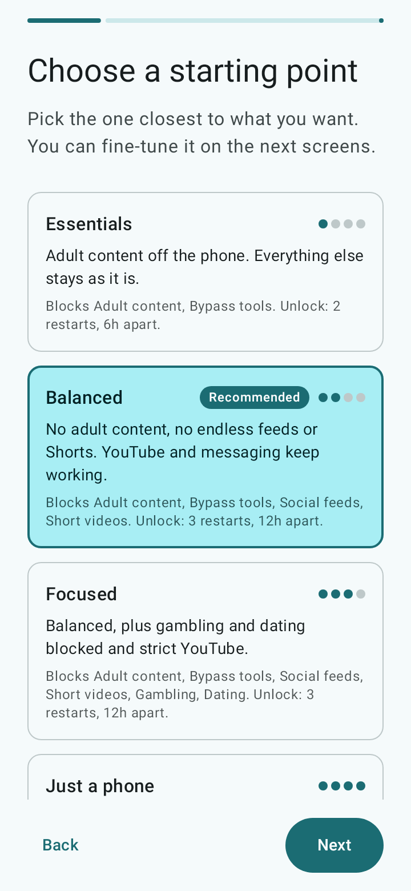
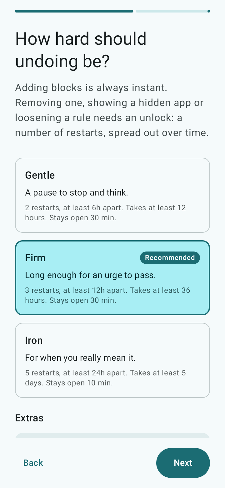
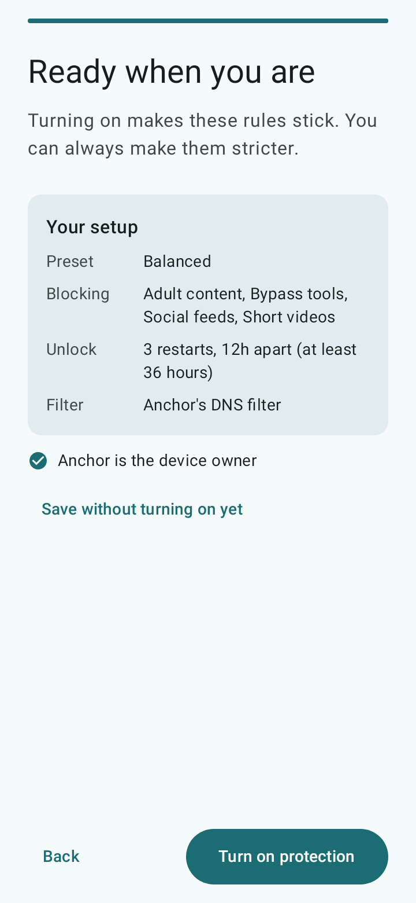

<p align="center">
  
</p>

<h1 align="center">Anchor</h1>

<p align="center">
  <b>A phone. A tool.</b><br>
  Not a doomscrolling or adult-content machine.
</p>

<p align="center">
  
  
  
  
</p>

Anchor is a device-owner app for Android. It blocks adult content and endless feeds in Chrome and every other app, hides the apps that pull you in, and can't be uninstalled or switched off in Settings. It follows one rule everywhere:

> **Stricter is instant. Looser needs an unlock.**

An unlock means requesting it in the app, then restarting the phone a set number of times, each restart hours apart. By the time it opens, the urge has passed.

## Setup in a minute

<p align="center">
  
  
  
  
</p>

| Preset | Blocks | Unlock |
|---|---|---|
| Essentials | Adult content, bypass tools | 2 restarts, 6 hours apart |
| **Balanced** (recommended) | + social feeds, short videos | 3 restarts, 12 hours apart |
| Focused | + gambling, dating, strict YouTube | 3 restarts, 12 hours apart |
| Just a phone | + video and streaming, no new apps | 5 restarts, 24 hours apart |

## Features

**Sites**
- Categories: adult content and bypass tools (proxies, Tor, translation proxies) are always on. Social feeds, short videos, video and streaming, gambling and dating are switches.
- Your own blocked sites, including paths like `youtube.com/shorts`, and an "Always allowed" list for mistakes.
- The [HaGeZi NSFW list](https://github.com/hagezi/dns-blocklists) of known adult sites, refreshed weekly, with Cloudflare for Families as the upstream DNS.

**Apps**
- Hide any app with one tap. Hidden apps stay installed with their data.
- Every browser except Chrome is hidden, including ones installed later, along with apps in active categories.
- The phone, SMS, home screen and Settings apps can never be hidden.

**Chrome**, locked down with managed policies
- Blocklists, no incognito, no secure DNS of its own, SafeSearch, YouTube restricted mode, Google's adult-site filter and no article feed. Check it on the phone at `chrome://policy`.

**DNS filter** (on by default)
- An on-device always-on VPN that only handles DNS lookups, so blocking works in every app.
- SafeSearch on Google, Bing and DuckDuckGo, and YouTube restricted mode, everywhere.
- Catches apps that try to use public resolvers such as Google, Cloudflare, Quad9, NextDNS or AdGuard directly.
- **Using AdGuard instead?** Turn Anchor's filter off. Anchor frees the VPN slot for the AdGuard app, and can lock Private DNS to your own hostname (`xxxxxxxx.d.adguard-dns.com`) so it can't be switched off.

**Rules**
- Restarts needed (1–5), hours between them (1–48) and how long an unlock stays open (10–60 minutes).
- Strict YouTube, and Freeze apps to stop any new installs.

**Always locked**
- VPN, Private DNS, date and time, extra users, app cloning, private space and factory reset in Settings.
- Release builds also turn off safe mode, USB debugging and sideloading.

## Build

With the Android SDK installed and `ANDROID_HOME` set:

```bash
./gradlew assembleDebug
```

- **Debug:** for testing. adb, safe mode and sideloading keep working, restarts only need to be minutes apart, and adb can remove the app.
- **Release:** the real thing.

GitHub Actions builds and lints every push to `main` and every pull request, and attaches both APKs to the run. Pushing a tag like `v0.1.0` publishes a signed GitHub release.

## Install

1. Turn on USB debugging: Settings › About phone › Software information › tap Build number 7 times, then Developer options › USB debugging.
2. Settings › Accounts and backup › Manage accounts: remove **every** account. Remove Secure Folder if you have one. Android refuses to set a device owner while accounts exist.
3. Install the app and make it device owner:

```bash
adb install -t app/build/outputs/apk/debug/app-debug.apk
```

```bash
adb shell dpm set-device-owner app.anchor/.protection.AdminReceiver
```

4. Add your accounts back, open Anchor and go through the setup wizard. Its last screen offers **Turn on protection**.

For a release build, install `app-release.apk` without `-t`. A debug build can be removed with `adb shell dpm remove-active-admin app.anchor/.protection.AdminReceiver`. A release build can only be removed through an unlock (Home › Turn Anchor off) or a factory reset from recovery mode.

## Test before going strict

On the debug build, check that:

- Blocked sites fail in Chrome and in other apps, and `chrome://policy` lists the policies.
- Google image search is SafeSearch-filtered in the Google app too.
- Samsung Internet is hidden, and a newly installed browser gets hidden.
- Banking apps work with the filter on.
- The adult-site list downloads (Sites tab), and the unlock flow works.
- With the filter off, AdGuard works and the Private DNS lock holds.

## Built-in lists

Categories live in [`categories.txt`](app/src/main/assets/categories.txt). The format is documented at the top of the file.

## Limits

- Factory reset from recovery mode can't be blocked. It's the emergency exit if something breaks.
- Shorts and Reels inside the YouTube and Instagram apps can't be blocked. Hide those apps instead.
- With the DNS filter on, the phone has no internet while the filter isn't running.
- Freeze apps can stop app updates too.
